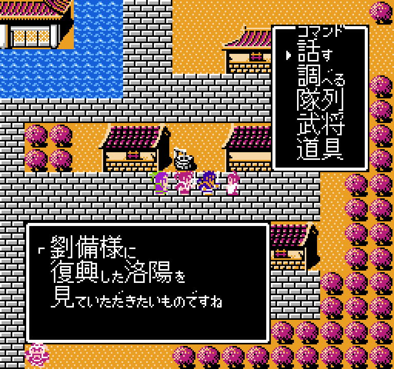
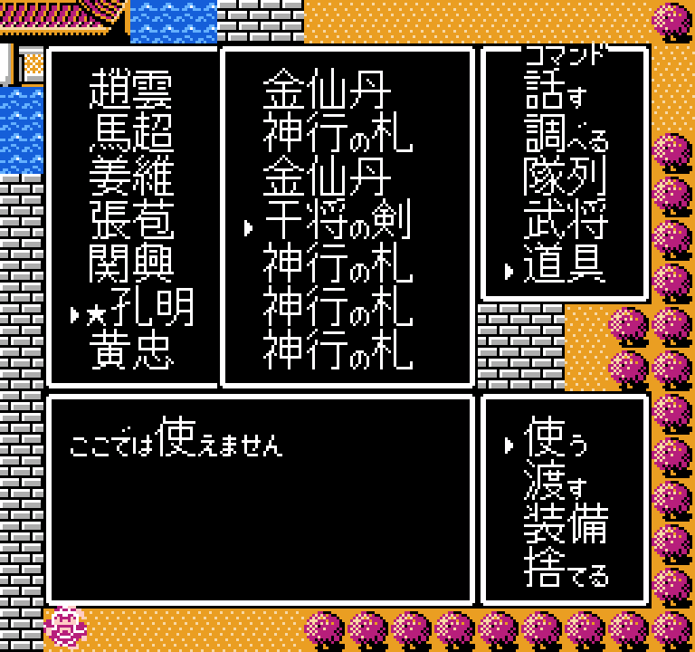
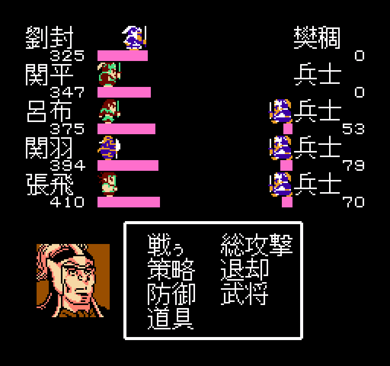
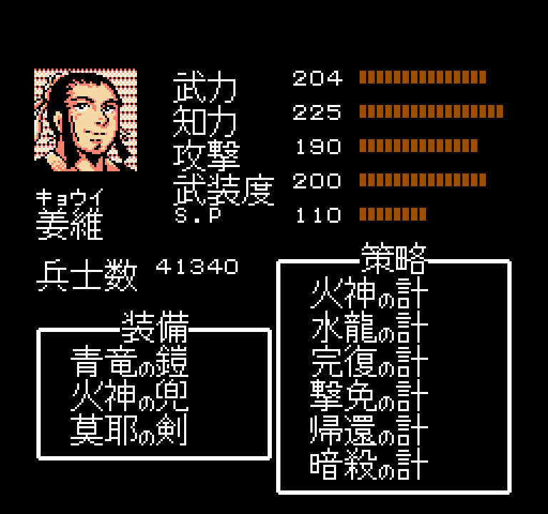

[English](README.md) | **日本語**

# 天地を喰らう 漢字・快適化版

カプコンのファミコン用RPG『天地を喰らう』（1989年）のファンパッチです。原作の文章はかなで書かれていて、漢字は戦闘画面やステータス画面の武将名だけでした。この版では文章を漢字かな交じりにし、あわせて遊びやすさに関わる点をいくつか改善しています。ストーリー、戦闘、数値などゲームの中身は原作のままです。

<p align="center">


<br>


</p>

## 変更点

### 漢字化

- **ゲーム中の文章すべて**
  - 会話、イベントのメッセージ、戦闘メッセージが対象です。
  - 漢字に合わせて改行を組み直しています。
  - フィールドでウィンドウに収まらないメッセージは、スクロールせず次のページに送ります。
- **武将名**：会話やメニューも含め、どこでも漢字で表示します。フィールド、戦闘、武将の情報画面、軍の状況画面のいずれもです。
- **メニューとウィンドウ**：コマンド、道具・策略・地名、店、所持金のウィンドウ（金／糧）、記録（記録／呼ぶ）。
- **戦闘画面**
  - コマンド
  - 道具と策略のウィンドウ
  - 戦闘後の報酬ウィンドウ（金・兵糧・経験値）
  - 捕虜のウィンドウ（仲間に入れる／逃がす）
- **タイトル画面とデモ**、起動時のメニュー（歴史書、名前の入力、文字の速さ）、**オープニングの誓いの場面**。
- **漢字は全部で1,007字**：どれも出水ビットマップフォント（JFドット出水ゴシック16）の16ドットの字形をそのまま使っています。アウトラインフォントを縮小したものではありません。

エンディングの締めくくり（スタッフロールとその後の画面）は、原作のかな表記のままです。ここも漢字化するかどうか迷いました。ただ、「すぺしゃる さんくす」までひらがなで書かれているあたり、開発陣があえて選んだ表記のように思えたので、手を加えずにそのまま残しています。

### 快適化

- **画面切り替えの短縮**
  - 戦闘の開始、軍の状況画面（セレクトボタン）、武将の情報画面は、画面が暗いあいだにまとめて組み立てます。原作の1フレームずつの待ちがなくなり、早く表示されます。
  - 戦闘の開始では、原作の待ちのあいだに乱数が進んでいました。この版でも同じ回数だけ進めるので、戦闘の乱数の結果は原作と同じです。
- **武将の情報画面で左右キー**：前後の武将に切り替えます。
  - 「武将」コマンドからは、隊列の順に表示します。
  - 町の「能力」からは、控えの武将を表示します。
  - 戦闘中は、残っている敵を表示します。
- **控えの武将は125人まで**（原作は64人）
  - 仲間になる武将は132人いるので、原作では一杯になることがありました。
  - 一覧は1ページ8人で、左右キーでページを切り替えます。矢印とページ番号で、いまどこにいるかがわかります。
- **扉を通っても音楽が途切れません**：次の場所の曲が同じとき（町とその中の建物など）は、止めて最初から流し直さずにそのまま続けます。扉の効果音は曲に重ねて鳴ります。
- **タイトルロゴの演出**が毎フレーム動きます（60fps）。原作では4フレームごとでした。
- **エンディングの最後の画面**でスタートボタンを押すと、タイトルに戻ります。

### 不具合の修正

- 「文字の速さを決めてください」のメッセージが、速さを選ぶ前に表示されるようになりました。原作では一度も表示されませんでした。

## 遊び方

1. [Releases](https://github.com/pig1800/tokqolfix/releases) のページから `tokqolfix.bps` をダウンロードします。
2. お手持ちのゲームの ROM に当てます。BPS に対応したパッチツールを使ってください（ブラウザで使える [Rom Patcher JS](https://www.marcrobledo.com/RomPatcher.js/) や [Flips](https://github.com/Alcaro/Flips) など）。

   | | |
   |---|---|
   | ファイル | `Tenchi o Kurau (Japan) (Rev 1).nes` |
   | サイズ | 262,160 バイト（NES 2.0 ヘッダー16バイト + 256KiB） |
   | CRC32 | `2CE2E0E3`（ヘッダーを除くと `637A7ACB`） |
   | SHA-1 | `a2da4abdd24344a23901eff294cacd054bc791fe` |

   - **ヘッダーが違う場合**：中身が同じでもヘッダーが違う ROM（ヘッダーを除いた CRC32 が `637A7ACB`）は、チェックサムが合わずに弾かれます。先にバイナリエディタで先頭16バイトを `4E 45 53 1A 10 00 12 08 00 00 70 07 00 00 00 01` に書き換えてください。
   - **ヘッダーがない場合**：ヘッダーのない ROM（262,144 バイト）は、この16バイトを先頭に付け足してください。
3. NES 2.0 ヘッダーに対応したエミュレーターで遊びます。
   - 512KiB の MMC3（マッパー4）で、CHR RAM 16KiB と4画面ネームテーブルを使います。普通の MMC3 基板にはない構成なので、実機での動作は確認していません。
   - [Mesen 2](https://www.mesen.ca/) で動作を確認しています。

### セーブについて

- **歴史書（セーブ）は3冊から2冊に**なりました。3冊目のぶんのバッテリーRAMを、漢字の表示に使っているためです。
- **原作のセーブは一度変換が必要です**。控えの武将の一覧の場所が変わったため、原作のバッテリーセーブを使うには、このリポジトリのツールで変換してください（Python 3 が必要です）。

  ```sh
  python -I tools/reserve_move.py original.sav converted.sav
  ```

  - 歴史書の1冊目と2冊目が引き継がれます。
  - Mesen ではセーブは `Saves/<ROMのファイル名>.sav` に置かれます。変換したファイルは、パッチを当てた ROM と同じ名前にしてください。
- **原作のステートセーブ**は引き継げません。

## 制限事項

- フィールドのメッセージでは、そのページで新しく出てくる漢字ごとに字形の読み込みを待つので、漢字はかなより少しゆっくり表示されます。

## クレジット

- 『天地を喰らう』© CAPCOM 1989。原作：本宮ひろ志。このパッチは非公式のもので、カプコンとは関係ありません。
- 漢字の字形：出水ビットマップフォント（Yu=Izumi 氏）を収めた JFドット出水ゴシック16（[jikasei.me](http://jikasei.me/)）。作者はパブリックドメインに準ずるものとしており、使用書体の記載を望ましいとしています。
- パッチ：pig1800

## ライセンス

MIT ライセンス（[`LICENSE`](LICENSE)）の対象は、このプロジェクト自身の成果物です。ツール類、この版のアセンブラ（`tools/asm/` と、`decomp/banks/` の中の改造部分）、ビルドスクリプト、ドキュメント、漢字の単語・人名リストがこれにあたります。

対象外のもの：
- **カプコンの著作物**：ゲーム本体、そのコードの逆アセンブル（`decomp/banks/`。この版の改造部分を除く）、ゲームの文章（`decomp/text/`。原作の文章をもとにした漢字版も含む）、スクリーンショット（`docs/images/`）。『天地を喰らう』© CAPCOM。
- **第三者のファイル**（それぞれの条件に従います）
  - `JF-Dot-Izumi16.ttf`：出水ビットマップフォント。パブリックドメインに準ずるものです（クレジット参照）。
  - `tools/toolchain/` の asm6f：loopy 氏ほかによるフリーソフトウェアです（同梱の readme 参照）。

配布用パッチには、この成果物とフォントの字形、漢字版の文章が含まれます。それぞれ上記の条件に従います。

## このリポジトリについて

パッチは、ゲームをバイト単位で同一に再構築したアセンブラソースからビルドしています。ソースはこのリポジトリにあります。ROM や ROM から取り出したデータは含まれていません。お手持ちの ROM（上記）を同じファイル名でリポジトリの直下に置いてから、次を実行します。

```sh
python tools/assets.py export           # 初回のみ：ゲームのグラフィックとデータの取り出し
python decomp/build.py                  # 原作（256KiB、元の ROM と同一）
python decomp/build.py --target kanji   # 漢字版：decomp/build/rom_kanji.nes
python -I tools/make_bps.py             # 配布用パッチ：out/release/tokqolfix.bps
```

ビルドには Python 3 と Pillow、fontTools が必要です。アセンブラ（asm6f）は `tools/toolchain` にあります。

- **原作のビルドは元の ROM と同一であること**：262,160 バイト、sha256 `40f19e179b84a4a2576d678dd97d9d1dc0925ea848841e6b030ffecfa73a8367`。
- **漢字版のビルド**では、固定バンクの検査（`tools/bank15_lint.py`）と `MEMORY_MAP.md` の再生成も行います。
- **`make_bps.py`** は、書き出したパッチを自分で当て直してビルド結果と照合します。元の ROM からコピーできるバイトはすべてコピーで済ませるので、パッチに入るのはこの版で新しく加えたデータだけです。

### ドキュメント（英語）

- [`STATUS.md`](STATUS.md)：現在のビルドの全体像（構成、ランタイム、文章の編集、ツール、テスト、制限）。
- [`TEXT_RENDERER.md`](TEXT_RENDERER.md)：すべての変更の設計記録。理由と計測結果を古い順に記しています。
- [`MEMORY_MAP.md`](MEMORY_MAP.md)：現在のビルドの PRG 全領域の一覧（自動生成）。
- [`decomp/README.md`](decomp/README.md)：再構築ソースについて（構成、CDL からの再生成、字形と文章の編集）。
- [`decomp/text/README.md`](decomp/text/README.md)：メッセージの形式と制御コード。
- [`assets/README.md`](assets/README.md)：取り出したグラフィック。

### 文章

- **漢字版の文章**は `decomp/text/kanji_plan/bank10_messages_kanji_r14.dtx` と `bank11_messages_kanji_r14.dtx` にあります。編集して漢字版をビルドしてください。
- **原作のかなの文章**は `decomp/text/bank10_messages.dtx` と `bank11_messages.dtx` にあります。編集して原作をビルドしてください。

### Mesen でのテスト

Mesen はバッテリーセーブを ROM のファイル名で管理します。テストは ROM を別名にコピーして実行してください（`tools/mesen_run.py` はそうしています）。そうすれば、自分のゲームのセーブには触れません。
