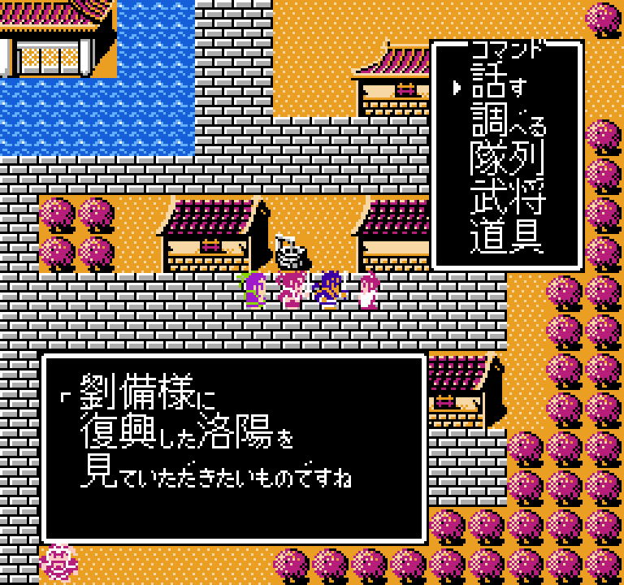
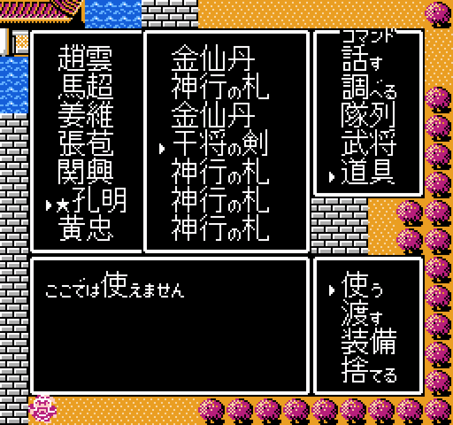
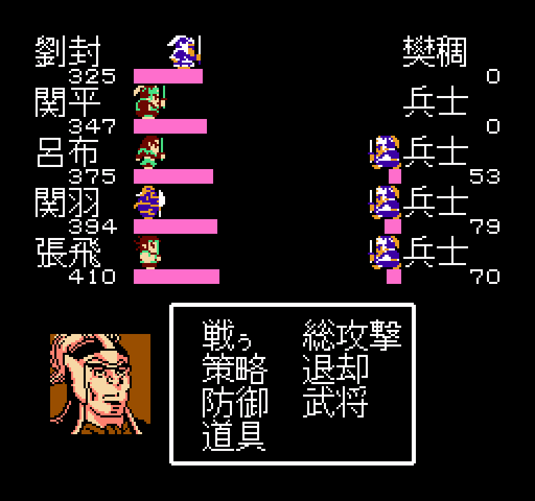
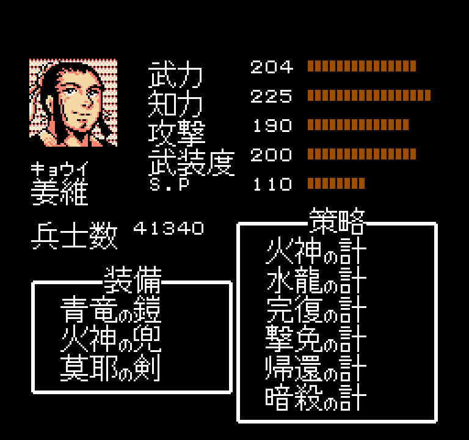

**English** | [日本語](README.ja.md)

# Tenchi o Kurau: kanji edition with QoL improvements

A fan patch for *Tenchi o Kurau* (天地を喰らう), Capcom's 1989 Famicom RPG,
released in North America as *Destiny of an Emperor*.  The original
writes its text in kana; only the officers' names on its battle and
status screens are in kanji.  This edition puts the game's text into
kanji and makes a number of quality-of-life improvements along the way.
The game itself is unchanged: the same story, battles and numbers.

<p align="center">


<br>


</p>

## What's new

### Kanji

- **All of the game's text.**
  - Covers every dialogue and event message and the battle messages.
  - The line breaks are reworked for kanji.
  - In the field, a message too long for its window goes on to a new
    page instead of scrolling.
- **Officer names** are in kanji everywhere, in messages and menus too:
  in the field, in battle, on the officer info screen and on the army
  status screen.
- **Menus and windows** are in kanji: the commands; item, tactic and
  place names; the shops; the gold window (金 / 糧); and saving (記録 /
  呼ぶ).
- **The battle screen** is in kanji:
  - the commands;
  - the item and tactic windows;
  - the reward window (金 兵糧 経験値);
  - the prisoner window (仲間に入れる / 逃がす).
- **The title screen and its demo**, the boot menus (history books,
  name entry, message speed) and the **opening oath** are in kanji.
- **1,007 kanji in all**, each one the 16-dot bitmap of the Izumi
  bitmap font (JF Dot Izumi Gothic 16), not shrunk from an outline font.

The ending's closing part (the staff roll and the screens after it) is
still in the original kana.  I hesitated over whether to put the ending
into kanji as well.  Its style, down to すぺしゃる さんくす written in
hiragana, looks like a deliberate choice by the developers, so I left it
as it is.

### Quality of life

- **Faster screens.**
  - The edition builds a battle's start, the army status screen (Select)
    and the officer info screen while the screen is black, without the
    original's frame-by-frame waits.  They come up sooner.
  - At a battle's start, the original's waiting frames advanced the
    random numbers.  The edition advances them the same number of times,
    so the battle's rolls are the original's.
- **Left / Right on the officer info screen** shows the officer before or
  after this one:
  - from 武将, your party in its order;
  - from a town's 能力, your reserve officers;
  - in battle, the enemies still standing.
- **A reserve list of 125 officers** instead of 64.
  - 132 officers can join you, so the original's list could fill up.
  - The list shows 8 officers a page.  Left / Right turn the pages, and
    arrows and a page number show where you are.
- **Doors keep the music** when the next area plays the same tune (a town
  and its houses, for example), instead of stopping it and starting it
  over.  The door's sound plays over it.
- **The title's logo intro** moves every frame (60 fps).  The original
  moved it every 4 frames.
- **On the ending's last screen**, Start takes you back to the title.

### Fixes

- The message speed prompt (文字の速さを決めてください) now shows before the
  speed choice.  The original never printed it.

## Playing it

1. Download `tokqolfix.bps` from the
   [Releases](https://github.com/pig1800/tokqolfix/releases) page.
2. Apply it to your own copy of the game.  Use a BPS patcher, such as
   [Rom Patcher JS](https://www.marcrobledo.com/RomPatcher.js/) (in the
   browser) or [Flips](https://github.com/Alcaro/Flips).

   | | |
   |---|---|
   | File | `Tenchi o Kurau (Japan) (Rev 1).nes` |
   | Size | 262,160 bytes (a 16-byte NES 2.0 header + 256 KiB) |
   | CRC32 | `2CE2E0E3` (without the header: `637A7ACB`) |
   | SHA-1 | `a2da4abdd24344a23901eff294cacd054bc791fe` |

   - **Different header.**  A copy with the right data but another header
     (CRC32 `637A7ACB` without it) fails the patcher's checksum check.
     Set its first 16 bytes to `4E 45 53 1A 10 00 12 08 00 00 70 07 00 00
     00 01` with a hex editor first.
   - **No header.**  A headerless copy (262,144 bytes) needs those 16
     bytes added in front.
3. Play it in an emulator that supports NES 2.0 headers.
   - The game is a 512 KiB MMC3 (mapper 4) ROM with 16 KiB of CHR RAM and
     four-screen nametables.  No standard MMC3 board has those, so real
     hardware is untested.
   - Tested in [Mesen 2](https://www.mesen.ca/).

### Saves

- **Two history books instead of three.**  The edition uses the third
  book's battery RAM for its text.
- **Original saves need a conversion.**  The reserve list moved in battery
  RAM, so convert a battery save from the original ROM once, with
  Python 3 and this repository's tool:
  `python -I tools/reserve_move.py original.sav converted.sav`.
  - Books 1 and 2 carry over.
  - Mesen keeps a game's save as `Saves/<ROM file name>.sav`, so give the
    converted file the patched ROM's name.
- **Save states from the original ROM** don't carry over.

## Known limits

- The item そうこうのふだ is still in kana.
- In the field, each kanji new to a message page waits for its glyph to
  be loaded, so kanji appear a little more slowly than kana.

## Credits

- *Tenchi o Kurau* © CAPCOM 1989, based on the manga by Hiroshi Motomiya
  (本宮ひろ志).  This patch is unofficial and not affiliated with Capcom.
- The kanji are from the Izumi bitmap font (出水ビットマップフォント) by
  Yu=Izumi, as packaged in JF Dot Izumi Gothic 16
  ([jikasei.me](http://jikasei.me/)).  Its author places it in the public
  domain and asks that its use be credited.
- Patch by pig1800.

## This repository

The patch is built from a byte-identical assembler reconstruction of the
game, which is in this repository.  The ROM is not here, nor is any data
taken from it.  Put your own copy (above) at the repo root under that
name, then:

```sh
python tools/assets.py export           # once: the game's graphics and data blocks
python decomp/build.py                  # the original, 256 KiB, byte-identical
python decomp/build.py --target kanji   # the kanji edition: decomp/build/rom_kanji.nes
python -I tools/make_bps.py             # the release patch: out/release/tokqolfix.bps
```

The builds need Python 3 with Pillow and fontTools.  The assembler
(asm6f) is in `tools/toolchain`.

- **The original build must stay byte-identical**: 262,160 bytes, sha256
  `40f19e179b84a4a2576d678dd97d9d1dc0925ea848841e6b030ffecfa73a8367`.
- **The kanji build** also lints the fixed bank
  (`tools/bank15_lint.py`) and regenerates `MEMORY_MAP.md`.
- **`make_bps.py`** applies the patch it writes and checks the result
  against the build.  It copies every byte it can from the original ROM,
  so the patch holds only the edition's own data.

### Documents

- [`STATUS.md`](STATUS.md): the kanji edition as built.  It covers the
  layout, the runtime, how to edit the text, the tools, the tests and the
  known limits.
- [`TEXT_RENDERER.md`](TEXT_RENDERER.md): the design log of every change,
  with its reasons and measurements, newest last.
- [`MEMORY_MAP.md`](MEMORY_MAP.md): every PRG region of the current build,
  generated.
- [`decomp/README.md`](decomp/README.md): the reconstruction (layout,
  regeneration from the CDL, glyph and text editing).
- [`decomp/text/README.md`](decomp/text/README.md): the message format and
  tokens.
- [`assets/README.md`](assets/README.md): the exported graphics.

### Text

- **The kanji edition's text** is in
  `decomp/text/kanji_plan/bank10_messages_kanji_r14.dtx` and
  `bank11_messages_kanji_r14.dtx`.  Edit those and run the kanji build.
- **The original game's kana text** is in
  `decomp/text/bank10_messages.dtx` and `bank11_messages.dtx`.  Edit
  those and run the original build.

### Testing in Mesen

Mesen keys battery saves by ROM file name.  Run tests on a copied ROM name
(`tools/mesen_run.py` does this) so that your own save of the game is
never touched.
